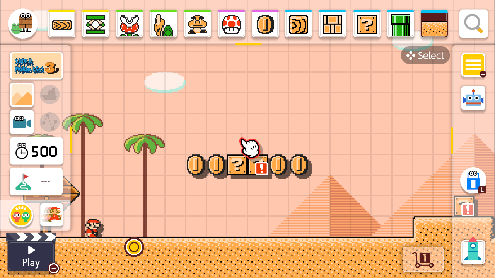

# Mushroom Maker Recomp - Native PC Recompilation

**Mushroom Maker Recomp** is an experimental native **Windows** port based on static AArch64 → C recompilation of *Super Mario Maker 2* (**v3.0.3**).

**Development status: experimental.** The game runs on PC, with work continuing on Course World integration, rendering, performance and stability. Full-game compatibility has not been established. Crashes, stalls and visual differences may still occur.

> [!IMPORTANT]
> **No game files are included.** You must provide your own legally obtained, complete game files with **update 3.0.3 already applied**. Update files alone are not sufficient.
> Instructions for obtaining game files will **NOT** be provided.
> Game-derived code and libraries are generated locally. The release supplies the launcher, translation tools, PC runtime support and third-party dependencies.



*An unmodified screenshot captured from the port's course editor during local testing.*

---

## Port Features

- **Native C execution**: Game instructions are translated from AArch64 to C and compiled locally into a native game library. A PC compatibility layer handles graphics, input, audio and operating-system calls.
- **Vulkan graphics**: The runtime translates the game's rendering commands and shaders for the PC GPU. Video settings include resolution scaling, FSR 1 / NIS upscaling and SMAA anti-aliasing.
- **Fullscreen and 120 FPS presentation by default**: Simulation retains its 60 Hz timing. Experimental frame generation adds intermediate displayed frames; it does not turn simulation into 120 FPS. Performance and image quality depend on the scene, hardware and settings.
- **4K output**: Resolution settings support 3840 × 2160 output. Original textures retain their source detail; higher output resolution does not replace them with HD artwork.
- **Keyboard, mouse and controllers**: Configurable bindings and button prompts for keyboard/mouse, Xbox, PlayStation and Nintendo layouts. During a course, left mouse jumps and right mouse performs the style-dependent spin action. Space also jumps.
- **In-game PC settings**: Press **Esc** or **Select / Back / Minus** on player 1's controller to open the Controls, Video, Audio, Mods and Quit tabs.
- **Course World integration**: Browse and download courses through the original interface using the public MariOver service. Metadata and thumbnails are cached locally. Page navigation continues as the service supplies more results. Availability and course compatibility can vary; this does not replace every Nintendo online feature.
- **Portable setup launcher**: Includes Python, the compiler and setup dependencies. No separate Python, MSYS2 or Clang installation is required. The launcher searches subfolders, checks supported files and shows preparation progress.
- **Open replacement fonts and silhouette avatars**: No shared system font files or Mii resources are required. Course World uses silhouette avatars; 3D Mii previews and outfits are unavailable.

---

## Architecture & Pipeline

```text
[ User-provided complete game files, version 3.0.3 ]
                         │
                         â–¼  Launcher validation and file discovery
[ Static AArch64 → C translation on the user's PC ]
                         │
                         â–¼  Included compiler + prebuilt PC support
[ Locally generated game library + native runtime ]
                         │
                         â–¼
[ MushroomMakerRecomp.exe → mm2_303_diag.exe ]
                         │
                         â–¼
[ Native PC execution with Vulkan graphics ]
```

First-time preparation compiles the game-derived code locally; PC support is already built. Completed objects are reused where possible after an interruption. Later launches reuse the prepared runtime. Preparation time varies with CPU, memory and storage speed.

The fast build compiles most generated game C at `-O0`, with selected scene-reload units at `-O2`. PC support code is optimized separately. The current release uses C and C++ runtime components. A Rust migration remains a future goal.

---

## Getting Started

### System Requirements

| Specification | Windows |
|---|---|
| **OS** | Windows 10/11, 64-bit, with .NET Framework 4.8 |
| **CPU** | x86-64; first preparation uses multiple CPU cores |
| **GPU** | Vulkan 1.3-capable GPU with an up-to-date driver |
| **RAM** | Enough for the game and local compilation; a tested minimum has not been established |
| **Storage** | Space for game files, included tools, generated code, build objects and downloaded courses |
| **Internet** | Required to fetch courses and thumbnails from the public service |

Windows is the currently packaged platform. Linux and macOS releases are not available. Minimum hardware and sustained frame-rate targets need testing on more PCs.

### How to Play (Release Packages)

1. Download the Windows package from this repository's **Releases** page when a release is available.
2. Extract the **entire package**. Keep its files together.
3. Have your complete, legally obtained game files ready with **version 3.0.3 applied**, outside the release folder.
4. Run **`MushroomMakerRecomp.exe`**.
5. Choose your game folder. You may select a parent folder; the launcher searches its subfolders automatically.
6. Choose **Check files**, then **Prepare game**. Keep the launcher open until preparation finishes. **Preparation details** shows each stage and its progress.
7. Choose **Play**. Subsequent launches reuse the prepared game.

The launcher accepts prepared files, checks supported executable hashes and leaves your source files in place. It does not unpack game containers or apply updates. See the [setup guide](docs/setup.md) for file checks, controls, progress reporting and troubleshooting.

Saves, settings, cached downloads, logs and generated game code stay in `%LOCALAPPDATA%\MushroomMakerRecomp`. Previous launcher profiles are migrated automatically when possible, preserving their contents. If migration is blocked, the previous profile remains in use.

For problems, choose **Open saved report** in the launcher. Game output is recorded in `last-run.log` inside your profile. Reports should include hardware, the affected course or menu, and the steps that trigger the issue. Review logs for personal paths before sharing; do not attach game files.

---

## Compiling from Source

The `main` branch contains source code, documentation and open assets. Download the ready-to-use application from [Releases](https://github.com/Apolinario-coder/MushroomMakerRecomp/releases); compiled launchers and portable dependency bundles are kept there.

### Windows launcher

The launcher uses the .NET Framework compiler included with Windows:

```powershell
powershell -NoProfile -ExecutionPolicy Bypass -File .\build-launcher.ps1
```

This builds `build/launcher/MushroomMakerRecomp.exe`. A runnable application also needs its resources and portable dependencies. To assemble and verify the complete Windows package, use Python 3.13 and an existing Windows release ZIP:

```powershell
python tools/package_release.py --portable-from "D:\Downloads\MushroomMakerRecomp-v1.0.0-Windows-x64.zip" --output dist/MushroomMakerRecomp-Windows-x64.zip
```

The packaging tool verifies the dependency bundle, rebuilds the launcher, copies current sources into the application's release layout and generates the package manifest and SHA-256 checksum. It does not download game files or include generated game libraries. Extract the resulting ZIP and use **Prepare game** with your own supported files.

The preparation script can also use a developer-supplied MSYS2/UCRT64 installation:

```powershell
python tools/setup.py prepare --dump "D:\My game files" --toolchain "C:\msys64\ucrt64"
```

See [the build guide](docs/build.md) for prerequisites and [setup instructions](docs/setup.md) for release usage.

| Path | Purpose |
|---|---|
| `runtime/host/` | PC runtime and native build scripts |
| `runtime/lifter/`, `runtime/sdk/` | Translation and SDK compatibility generation |
| `tools/launcher/` | Launcher code, layout, manifest and animation timing |
| `tools/setup.py` | Supported-file validation, preparation and launch |
| `tools/package_release.py` | Verified Windows release assembly |
| `tools/` | Course World workers and maintenance tools |
| `assets/`, `defaults/` | Branding, open replacement fonts and initial settings |
| `third_party/` | Preserved component notices and dependency origins |
| `docs/` | Setup and build documentation |

Most generated game code retains the fast `-O0` build. Seventeen selected 3.0.3 heap/resource construction units use `-O2` to reduce course reload work after death. A separate `control.nacp` file is not required; supported executable hashes identify the game version.

Source checks:

```powershell
python -m unittest discover -s tools/tests -v
```

---

## Acknowledgments & Special Thanks

Thanks to the developers of **LAS Recomp**, **Sky Recomp** and the projects credited in the preserved source notices. Their recompilation and PC rendering work provides foundations for parts of this runtime.

Thanks also to **TheGreatRambler** for MariOver and its public course service, and to **OpenSmash-Ultimate/ssbu-recomp** for the documented open font package used as the source for this port's replacements.

---

## Credits

### Projects & Foundations

- **[LAS Recomp](https://github.com/peiikai/LASRecomp)**: Runtime foundations used by inherited components; see [its preserved notice](third_party/licenses/LASRECOMP-LICENSE.txt).
- **Sky Recomp**: Adapted PC rendering components; see [its preserved notice](third_party/licenses/SKYRECOMP-LICENSE.txt).
- **[MariOver](https://github.com/TheGreatRambler/MariOver)** by TheGreatRambler: Course service integration and supporting code; see [the included license](tools/mariover-LICENSE.txt).
- **[OpenSmash-Ultimate/ssbu-recomp](https://github.com/OpenSmash-Ultimate/ssbu-recomp)**: Source and provenance of the open replacement font package.

### Visual Assets

- **Mushroom Maker Recomp branding**: Project icon and banner; see [the branding notes](assets/branding/README.md).
- **In-game screenshot**: Captured from a local test of the port. Original game artwork belongs to its respective owners.

### Libraries and Tools

- **[SDL 3](https://libsdl.org)**: Controller and input support.
- **[glslang](https://github.com/KhronosGroup/glslang)** and **[SPIRV-Tools](https://github.com/KhronosGroup/SPIRV-Tools)**: Shader compilation and processing.
- **[LLVM / Clang](https://llvm.org)** and **[MSYS2](https://www.msys2.org)**: Native compiler and packaged Windows toolchain.
- **[Python](https://www.python.org)**, **[Pillow](https://python-pillow.org)** and **[cryptography](https://cryptography.io)**: Preparation and Course World helpers.
- **[SMAA](https://github.com/iryoku/smaa)**: Anti-aliasing; see [the included license](third_party/licenses/SMAA-LICENSE.txt).
- **Open Sans**, **Source Sans Pro** and **YuzuOSSExtension / MM2 PC Symbols**: Replacement fonts; see [sources, modifications and licenses](assets/fonts_open/README.md).

---

## Legal & License

Mushroom Maker Recomp is an independent, unofficial fan project. It is not affiliated with, endorsed by or sponsored by Nintendo. *Super Mario Maker 2* and its original characters and artwork belong to Nintendo and their respective rights holders.

**Original game executables, game data, firmware and keys are not bundled.** Users supply their own game files, and game-derived output stays on their PC. The documentation screenshot shows the original game and is not a replacement asset pack.

Third-party code, fonts and tools retain their authors' notices and license terms. The project does not apply a blanket license to all inherited runtime code. See [NOTICE.md](NOTICE.md), [component notices](third_party/licenses/) and the included toolchain and font licenses. Inherited runtime provenance and licensing still require review before public distribution.

---

## Source Code of Bundled Third-Party Components

The release ZIP manifests record dependency versions and checksums. Compiler package versions and source locations are recorded in `ORIGIN.json` inside `portable/toolchain.zip`. Python and helper origins are recorded in [third_party/python-origin.json](third_party/python-origin.json).

| Component | Packaged version | Source / license information |
|---|---|---|
| **CPython** | 3.13.9 | [Python source](https://www.python.org/downloads/source/); PSF license and included notices |
| **SDL 3** | 3.4.10 | [SDL repository](https://github.com/libsdl-org/SDL); zlib license |
| **LLVM / Clang** | 22.1.7 | [LLVM repository](https://github.com/llvm/llvm-project); Apache-2.0 with LLVM exception |
| **glslang** | 16.2.0 | [glslang repository](https://github.com/KhronosGroup/glslang); upstream notices |
| **SPIRV-Tools** | MSYS2 package `3~1.4.350.0-1` | [SPIRV-Tools repository](https://github.com/KhronosGroup/SPIRV-Tools); Apache-2.0 |
| **GCC runtime** | MSYS2 package `16.1.0-5` | [GCC sources](https://gcc.gnu.org/); runtime exceptions and component notices |
| **winpthreads** | MSYS2 package `14.0.0.r92.g818fa6510-1` | [mingw-w64 sources](https://www.mingw-w64.org/); MIT and BSD notices |
| **Pillow** | 13.0.0 | [Pillow repository](https://github.com/python-pillow/Pillow); included notices |
| **cryptography** | 50.0.2 | [cryptography repository](https://github.com/pyca/cryptography); included notices |
| **cffi / pycparser** | 2.1.1 / 3.12 | [cffi](https://github.com/python-cffi/cffi), [pycparser](https://github.com/eliben/pycparser); included notices |
| **Open replacement fonts** | Recorded in the font manifest | [Font provenance and licenses](assets/fonts_open/README.md) |

The compiler subset comes from [MSYS2 UCRT64 packages](https://repo.msys2.org/mingw/ucrt64/), with build recipes in [MINGW-packages](https://github.com/msys2/MINGW-packages). `portable/manifest.json` in the release ZIP inventories the tools, and `portable/prebuilt/support-sources.json` in the release ZIP lists the prebuilt PC support sources. These records do not establish a completed license-compliance audit.
