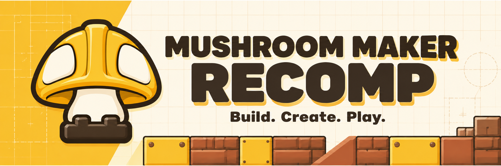

# Mushroom Maker Recomp

An experimental Windows PC port with a construction-themed launcher. The launcher prepares your own game files and starts the locally compiled runtime. This is an independent fan project, unaffiliated with Nintendo.

## What you need

- Windows 10 or 11, 64 bit, with .NET Framework 4.8 and a Vulkan-capable graphics driver.
- Your own Super Mario Maker 2 files, with **update 3.0.3 applied**. This build accepts the supported `main` and `sdk` hashes only. Other versions are rejected before compilation.
The release includes its setup helper, compiler, shader compiler and redistributable runtime libraries. You do not need to install Python, MSYS2, Clang or build dependencies. Extract the whole release folder before opening the launcher.

The first preparation translates and compiles your game files on your PC. Generated game C uses `-O0`, matching the fast-build approach used by SkyRecomp; the independent PC support code remains optimized and is already built; game instructions and SDK data are generated locally. Worker count adapts to available CPU cores and memory, up to 16. Completed objects are reused after an interrupted build. Preparation details reports stage timings. Actual build time depends on your hardware; a four-minute maximum is not guaranteed.

## Choose your game folder

Keep your private files outside this release folder. Export the **merged** game after applying update 3.0.3; an update-only RomFS does not contain the full game. Select any parent folder containing the extracted files. The launcher searches its subfolders automatically, so folder names and nesting do not need to match the example below. ExeFS files may also sit beside the RomFS directories in the same folder. Your files are used in place and are never rearranged.

Keep the internal RomFS layout intact (for example, `Pack`, `Model` and `Sound`). If several complete RomFS exports are found, choose a narrower parent folder to identify the one to use.

```text
My game dump/
  exefs/
    main
    sdk
    main.npdm
  romfs/
    Pack/
    Model/
    Sound/
    ...                  # The complete merged RomFS

```

The launcher does not extract or decrypt NSP/XCI containers, apply update patches, obtain firmware, download game files or accept keys. Prepare the merged folders before opening it. The executable hashes identify the supported version. No separate control.nacp export is required.

## Start the game

1. Double-click `MushroomMakerRecomp.exe` and choose your game folder.
2. Choose **Check files**, then **Prepare game**. Open **Preparation details** to see progress. Keep the launcher open until preparation finishes. If a build fails, the details show the error; rerunning preparation reuses completed objects where possible.
3. Choose **Play**. Later launches reuse the generated runtime. Source updates create a separate build automatically.

The progress bar shows the current step and its completed items. Percentages apply to that step, rather than estimating the time remaining. Unknown-size steps show activity until their item count is available. **Open saved report** opens the technical preparation report in your Windows profile.

During a course, **left mouse** is normal jump and **right mouse** is spin (ZR). Space also jumps. The spin action follows the selected game style. Left-click still selects items in menus and draws in the editor. You can change these bindings in PC settings.

Press **Esc** on the keyboard or **Select / Back / Minus** on a controller to open PC settings. The shortcut uses the controller's mapped Minus action for player 1. Press it again to close settings. Use the D-pad or left stick to move, A to select, B to go back, and L/R to change tabs. Keyboard Tab remains the game's Minus action.

The launcher opens to fit its content and stays within your monitor's work area. Smaller windows scale the layout to keep every field and action visible without page scrolling. Panels enter in a short sequence, and buttons respond to mouse and keyboard input. The effects follow the Windows animation preference. The activity indicator stops when the launcher loses focus, including while you play.

Keep all launcher files together, including `Launcher.xaml` and `timeline.json`.

Saves, settings, logs, cached downloads and locally generated game code stay in `%LOCALAPPDATA%\MushroomMakerRecomp`. Existing profiles are migrated automatically when no game session is running. If migration is blocked, the launcher keeps using the previous profile. The release folder contains no user data. `last-run.log` records game output. Preparation details may contain local paths; review logs before sharing them.

## Contents and source

The source repository stores the launcher in `tools/launcher/`, the preparation script in `tools/setup.py` and the runtime in `runtime/`. The packaged application uses the flat layout expected by the launcher: `Launcher.xaml`, `timeline.json`, `setup.py` and `src/` beside the executable.

See [Building from source](build.md) for launcher compilation and complete Windows package assembly. The main branch contains sources; compiled applications and portable tools are supplied through Releases.

No game assets, generated Nintendo code, game DLL, firmware, Nintendo system fonts, keys, saves, database credentials or caches are included. Runtime DLLs are built or copied from your local toolchain during preparation. Refer to [NOTICE.md](../NOTICE.md) and the preserved third-party notices for source licensing. This folder has been prepared for review; inherited runtime licensing still needs confirmation before public distribution.

The port remains experimental. The setup and runtime need testing on more PCs; stable frame rates and crash-free gameplay are not guaranteed. Course World uses the public MariOver service, whose availability is outside this project's control.

## Fonts and avatars

Open Sans, Source Sans Pro and the open-source MM2 PC Symbols replacement are included with their license notices and source. Firmware fonts and Mii resource archives are not required. Some private symbols use a geometric placeholder; text may differ from the console.

Course World uses the game's default silhouette icons. The port skips Mii model generation and does not contact an avatar-rendering service. Firmware Mii resource archives are not required; 3D Mii previews and outfits are unavailable in this mode.

## Included tools and licenses

`portable/python` contains the application-local CPython runtime and the Course World helper dependencies, including their licenses. `portable/toolchain.zip` contains a relocatable MSYS2 UCRT64 compiler subset and its license notices; it is unpacked into your Windows profile on first preparation. Its `ORIGIN.json` identifies package versions and upstream source locations. `portable/prebuilt/support-sources.json` lists the independent PC sources used in `host-support.a`; it explicitly excludes the two SDK-derived source files. All these artifacts have checksums in `portable/manifest.json`.

Release authors can assemble the current source tree with `tools/package_release.py` using an inventoried portable bundle from an existing Windows release. Developer preparation can pass `--toolchain` to `tools/setup.py` to use a local compiler. See the [build guide](build.md).
